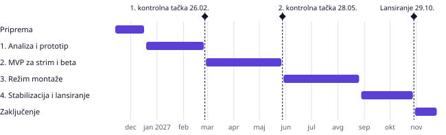
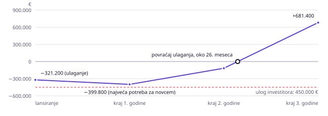
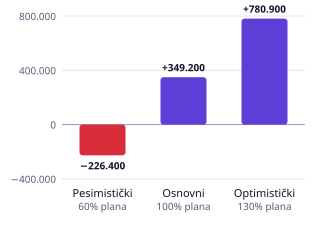
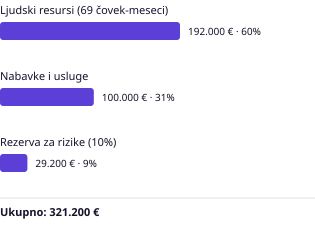

# Sažetak projekta KadarGlas

AI glasovni asistent za video montažu i striming uživo

USP Tim 1, 10.11.2026.

## Ukratko

NovaKadar d.o.o. je novootvoreni startup sa četiri osnivača, bez proizvoda i prihoda. Projektom pravimo KadarGlas, desktop aplikaciju koja na srpskom i engleskom jeziku glasom upravlja OBS Studiom, DaVinci Resolveom i Premiere Proom. Osnovna verzija je besplatna, a Pro košta 10 EUR mesečno. Projekat finansira anđeo investitor, traje od 10.11.2026. do 26.11.2027, a javno lansiranje je 29.10.2027.

## Ključni brojevi

| Pokazatelj         | Vrednost                       | Pokazatelj    | Vrednost                                     |
| ------------------ | ------------------------------ | ------------- | -------------------------------------------- |
| Ulaganje           | 321.200 EUR                    | NPV (15%)     | 349.200 EUR                                  |
| Investitor         | 450.000 EUR za 18% udela       | IRR           | 48,2%                                        |
| Prihod za 3 godine | 2.340.000 EUR                  | Povraćaj      | oko 26 meseci od lansiranja                  |
| Tim                | 4 osnivača, 8 ljudi na lansiranju | Eksploatacija | 336.600 EUR godišnje i 1,40 EUR po korisniku mesečno |

## Izvodljivost

| Oblast        | Ocena          | Obrazloženje                                                                  |
| ------------- | -------------- | ----------------------------------------------------------------------------- |
| Finansijska   | Da             | Ispunjava sva četiri kriterijuma; investitor pokriva i gubitak prve godine    |
| Tehnička      | Da, uz proveru | Tačnost za srpski, brzinu odziva i API-je programa proverava prototip         |
| Organizaciona | Da             | MVP prave osnivači, četiri nova člana tima dolaze posle bete                  |
| Kulturološka  | Da, uz mere    | 52% anketiranih strimera i montažera bi probalo; glas se obrađuje samo na zahtev |
| Operativna    | Da             | Ceo tim ostaje na proizvodu; programi kojima upravljamo rade i bez asistenta  |
| Rizici        | Visoki         | Ako proizvod ne uspe, firma se gasi; novac stiže u tranšama, uz kontrolne tačke |

## Faze i rokovi

- priprema i ugovor sa investitorom do 18.12.2026.
- 1\. faza, analiza i prototip, do 26.02.2027. (kontrolna tačka)
- 2\. faza, MVP za strim i beta, do 28.05.2027. (kontrolna tačka, druga tranša)
- 3\. faza, režim montaže, do 27.08.2027, uz četiri nova člana tima
- 4\. faza, stabilizacija i javno lansiranje, do 29.10.2027.
- zaključenje projekta do 26.11.2027.

## Glavni rizici

Najviše nas brine to što nemamo postojeće korisnike, pa ih tek treba privući. Slede tačnost za srpski jezik, odziv duži od 800 ms tokom strima i promene API-ja programa kojima upravljamo. Projekat izlazi na nulu na 76% planiranog prihoda.

## Preporuka

Preporučujemo da se projekat pokrene. Do prve kontrolne tačke troši se oko 80.000 EUR, a o drugoj tranši i zapošljavanju odlučuje se tek posle bete za strim.

*Kompanija NovaKadar i njeni interni podaci izmišljeni su za potrebe primera. Detalji su u Studiji izvodljivosti i Nacrtu projekta.*

<h2 class="nova-strana bez-broja">Grafički prikaz</h2>

<figure class="siroko"><figcaption><b>Slika 1. Faze projekta.</b> MVP za strim prave četiri osnivača. Posle druge kontrolne tačke stiže druga tranša, tim se širi i počinje rad na režimu montaže.</figcaption></figure>
<figure class="siroko"><figcaption><b>Slika 2. Kumulativni neto tok novca od lansiranja.</b> Najveća potreba za novcem, 399.800 EUR na kraju prve godine, ostaje ispod 450.000 EUR koje ulaže investitor. Ulaganje se vraća oko 26. meseca.</figcaption></figure>
<figure><figcaption><b>Slika 3. NPV za tri godine po scenarijima (15%).</b> Projekat je osetljiv na broj korisnika: izlazi na nulu na 76% planiranog prihoda.</figcaption></figure>
<figure><figcaption><b>Slika 4. Struktura ulaganja u realizaciju.</b> Tri petine ulaganja odlazi na rad tima.</figcaption></figure>

